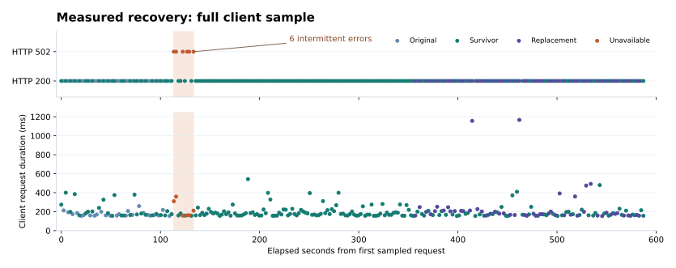

# Resilient AWS CloudOps Web Service

A Linux web service across two Availability Zones, with private application servers, automated instance replacement, centralized logs, and a measured recovery exercise.

**Owner:** [Ivan Garza · devgarza-ai](https://github.com/devgarza-ai)<br>
**Release:** `v1.0-console` · AWS operations portfolio

[](https://hub.xerj.org/contributors/devgarza-ai)

[Architecture](docs/architecture.md) · [Deployment](docs/deployment.md) · [Operations](docs/operations.md) · [Recovery incident](docs/incidents/recovery-incident.md) · [Security evidence](docs/security-and-audit.md)


## What this project demonstrates

The service addresses an operational problem: a virtual machine can remain running while its web application is unavailable. An Application Load Balancer checks the application's `/health` endpoint. EC2 Auto Scaling uses ELB health results to replace a failed application server, while CloudWatch and SNS notify the operator.

The console implementation connects VPC routing, security group references, EC2 user data, IAM roles, Systems Manager, application logs, health checks, and audit evidence into one working service. The recovery exercise measures the actual client impact rather than assuming that redundant servers eliminate every failed request.

## Verified recovery result

| Measurement | Observed result |
| --- | ---: |
| HTTP requests sampled | 265 |
| HTTP 200 responses | 259 — **97.74%** |
| HTTP 502 responses | 6 |
| First-to-last failing request-start span | 19.921 seconds, with successful requests interleaved |
| Successful samples after the final error | **204 consecutive HTTP 200 responses** |
| Successful-request median / p95 duration | 176 ms / 385 ms |
| Final application state | Two healthy targets; CloudWatch alarm OK |

The six failures remain part of the result. The success percentage describes this request sample; it is not a production availability SLA. The exact fault-injection timestamp was not captured, so exact MTTR is not reported.



Read the [recovery incident report](docs/incidents/recovery-incident.md), inspect the [normalized observations](evidence/recovery-observations.csv), or [recalculate the summary](#verify-the-repository-locally).

## Implementation

| Area | Components and behavior |
| --- | --- |
| Network | Custom VPC; two public and two private subnets across `us-east-1a` and `us-east-1b` |
| Application delivery | Public HTTP ALB; Nginx application targets in private subnets |
| Compute | Arm64 `t4g.micro`; launch template; ASG minimum / desired / maximum of `2 / 2 / 2` |
| Administration | Systems Manager Session Manager; EC2 instance role; no inbound SSH rule |
| Recovery | ELB health checks enabled on the ASG; repeatable application bootstrap |
| Monitoring | HealthyHostCount alarm; confirmed SNS alarm email |
| Logs | CloudWatch agent; Nginx access/error and bootstrap log groups; seven-day retention |
| Auditing | Multi-Region CloudTrail management-event trail to S3; successful tag change found in the delivered log |
| Configuration checks | AWS Config `restricted-ssh` and `encrypted-volumes`; evaluated resources reported Compliant |

## Design boundaries

- **Availability scope:** application instances span two AZs. Both private subnets use one NAT gateway in the first AZ, creating an egress dependency.
- **Transport:** this release uses HTTP with synthetic page content. HTTPS, a custom domain, and production traffic were not implemented.
- **Capacity:** the fixed two-instance ASG demonstrates replacement. Demand-based elasticity and load-capacity testing were not performed.
- **Costs:** project-specific infrastructure charges and budget alert configuration/delivery are pending verification. The project is not represented as free to run.
- **Provisioning:** this release documents the console build. Terraform is the planned next implementation, not a completed feature.

## Repository guide

| Path | Purpose |
| --- | --- |
| [docs/architecture.md](docs/architecture.md) | Network layout, traffic paths, component relationships |
| [docs/deployment.md](docs/deployment.md) | Console configuration and verification procedure |
| [docs/operations.md](docs/operations.md) | Service checks, diagnostics, controlled recovery procedure |
| [docs/security-and-audit.md](docs/security-and-audit.md) | Security controls, audit evidence, verification boundaries |
| [docs/decisions.md](docs/decisions.md) | Design decisions and engineering tradeoffs |
| [docs/costs.md](docs/costs.md) | Cost drivers and unresolved cost evidence |
| [docs/incidents/recovery-incident.md](docs/incidents/recovery-incident.md) | Measured failure and recovery results |
| [docs/evidence.md](docs/evidence.md) | Evidence index and provenance |
| [scripts/](scripts/) | Application bootstrap, reusable probe, evidence analysis, repository checks |
| [config/](config/) and [iam/](iam/) | CloudWatch agent configuration and IAM policy templates |
| [evidence/](evidence/) | Sanitized observations and normalized audit/compliance extracts |

## Verify the repository locally

Python 3.10 or later and Bash are sufficient; no AWS credentials are required for these checks.

```bash
python3 scripts/validate_repository.py
python3 -m unittest discover -s tests -v
python3 scripts/analyze_recovery.py evidence/recovery-observations.csv --check evidence/recovery-summary.json
bash -n scripts/bootstrap.sh
```

These commands validate the public artifacts and recalculate the recorded test. They do not deploy AWS resources or perform another failure exercise. The GitHub workflow runs the same local checks.

## Ownership and implementation context

Built and operated by Ivan Garza as an AWS cloud operations portfolio project. The AWS environment was configured through the console, and the application-failure exercise was performed against that environment. Bootstrap/probe tooling, analysis, and documentation were developed with AI assistance and checked against the supplied outputs. Portfolio results are distinguished from professional employment experience.

See [release notes](docs/releases/v1.0-console.md) and the [MIT license](LICENSE).
