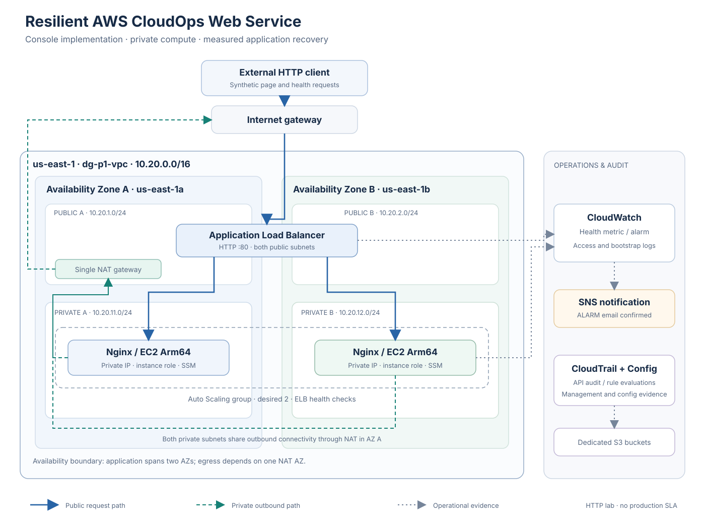

# Architecture

## Service objective

Serve a small synthetic web page from private Linux instances, recognize an application-level failure, replace the affected instance, and retain enough operational evidence to explain the outcome.

## Network layout

The workload runs in `us-east-1` within VPC `dg-p1-vpc`, using `10.20.0.0/16`.

| Logical subnet | Availability Zone | CIDR | Default route | Role |
| --- | --- | --- | --- | --- |
| Public A | `us-east-1a` | `10.20.1.0/24` | Internet gateway | ALB placement and the NAT gateway |
| Public B | `us-east-1b` | `10.20.2.0/24` | Internet gateway | Second ALB placement |
| Private A | `us-east-1a` | `10.20.11.0/24` | NAT gateway in Public A | Application instance |
| Private B | `us-east-1b` | `10.20.12.0/24` | Same NAT gateway in Public A | Application instance |

Each subnet also has the VPC-local route. The public route table is associated with both public subnets. Each private subnet has a private route table. The application launch template disables public IPv4 assignment.

### Inbound request path

The client resolves the ALB hostname and sends an HTTP request to port 80. The internet-facing ALB spans the public subnets and forwards the request to a healthy private target on port 80. The application response includes the backend hostname, allowing the probe to identify which server answered.

The NAT gateway is not in this inbound request path. ALB-to-target traffic uses private VPC connectivity. Return traffic for an ALB connection flows back through that connection rather than through the NAT gateway.

### Outbound application connectivity

Private instances initiate outbound connections through the shared public NAT gateway. This supports package installation and access to AWS service endpoints for management and log delivery. The NAT uses an Elastic IP and an internet gateway route in its public subnet.

Both private subnets depend on one AZ for this outbound path. Cross-AZ egress from Private B is a deliberate lab compromise, not a claim of resilient egress. Interface endpoints and a NAT per AZ were not deployed.

## Security group relationships

| Group | Inbound | Outbound |
| --- | --- | --- |
| `dg-p1-alb-sg` | TCP 80 from `0.0.0.0/0` | TCP 80 to `dg-p1-web-sg` |
| `dg-p1-web-sg` | TCP 80 from `dg-p1-alb-sg` | TCP 80 and 443 to `0.0.0.0/0` |

The web group references the ALB group rather than allowing the internet directly. No inbound SSH rule or bastion host is used. The rules describe this HTTP lab; they are not a production TLS design.

## Compute and application lifecycle

| Component | Configuration |
| --- | --- |
| Launch template | `dg-p1-web-lt`, ASG explicitly pinned to numeric version 2 |
| Instance | Amazon Linux, Arm64, `t4g.micro` |
| Root volume | 8 GiB gp3; encryption and delete-on-termination configured |
| Authentication | EC2 role `dg-p1-ec2-role`; no key pair |
| ASG | `dg-p1-asg`; min 2, desired 2, max 2; private subnets in two AZs |
| Health sources | EC2 and Elastic Load Balancing |
| Health-check grace period | 600 seconds |
| Target group | `dg-p1-web-tg`; instance targets; HTTP port 80 |
| Application health | `/health`, success 200, interval 15 seconds, timeout 5 seconds, thresholds 2 healthy / 2 unhealthy |

The [bootstrap script](../scripts/bootstrap.sh) installs Nginx and the CloudWatch agent, loads the logging configuration from Parameter Store, writes the page and health file, validates Nginx, starts the service, and checks local HTTP health.

The ASG's desired capacity is a steady baseline. There is no demand-scaling policy in this release. An unhealthy application instance can still be replaced at the fixed desired capacity.

## Recovery and notification are separate paths

| Path | Trigger | Result |
| --- | --- | --- |
| Application recovery | ELB health reports a registered instance unhealthy; the ASG consumes ELB health checks | ASG replaces the affected instance |
| Operator notification | Minimum HealthyHostCount falls below 2 for one 1-minute evaluation period | CloudWatch enters ALARM and publishes to SNS |
| Application evidence | CloudWatch agent tails configured local files | Log events arrive in per-instance streams |
| Audit evidence | Account API activity | CloudTrail management events delivered to S3 |
| Configuration evidence | AWS Config rule evaluation | Compliance result for recorded security groups and volumes |

The HealthyHostCount alarm does not trigger replacement in this configuration. The failed-instance activity confirms that the ELB health check caused replacement.

## Boundaries demonstrated by the exercise

One Nginx service failure was tested. The evidence does not establish performance under load, failure of an entire AZ, resilient NAT egress, or a production availability target. A replacement server and the surviving server were healthy at final verification; the full request sample still contains six transient HTTP 502 responses.

References: [ASG health checks](https://docs.aws.amazon.com/autoscaling/ec2/userguide/health-checks-overview.html), [ALB target health](https://docs.aws.amazon.com/elasticloadbalancing/latest/application/target-group-health-checks.html).
